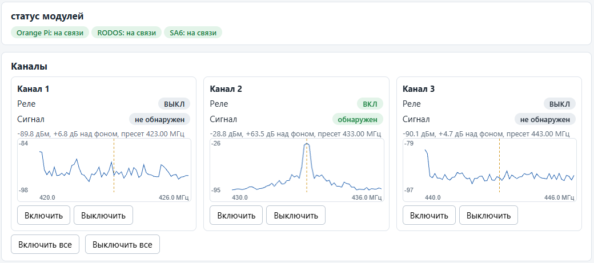
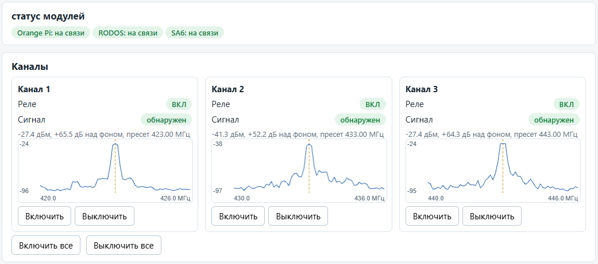
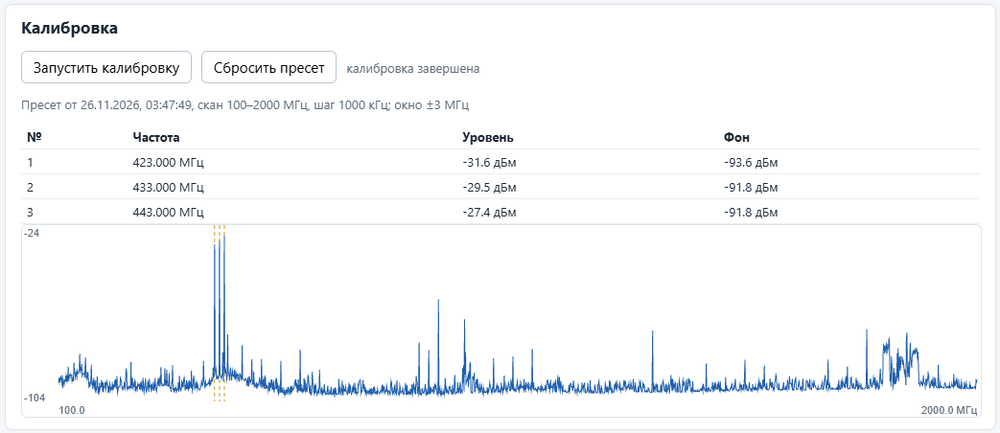
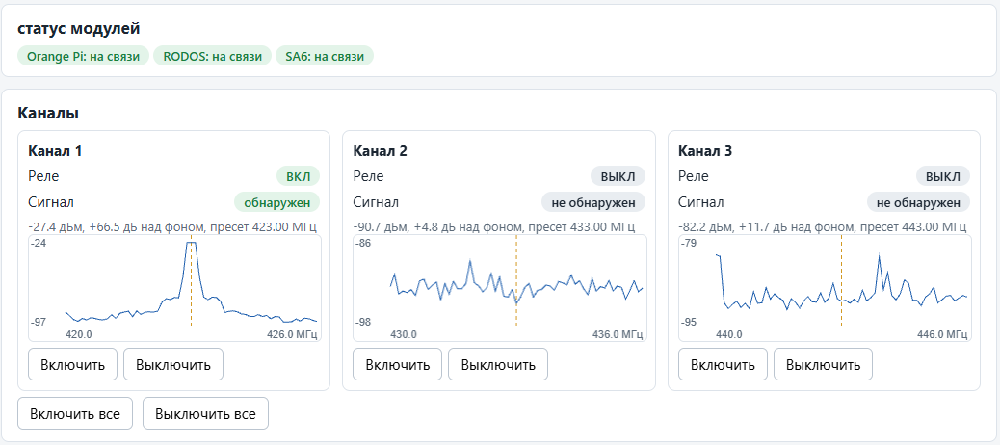
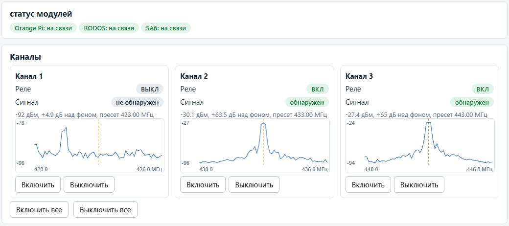
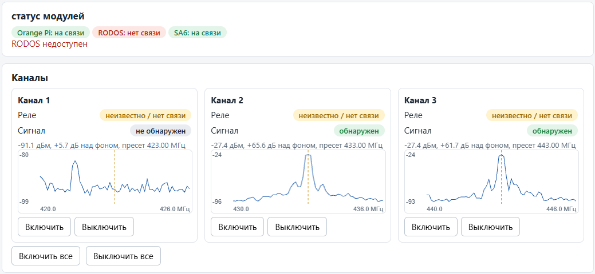
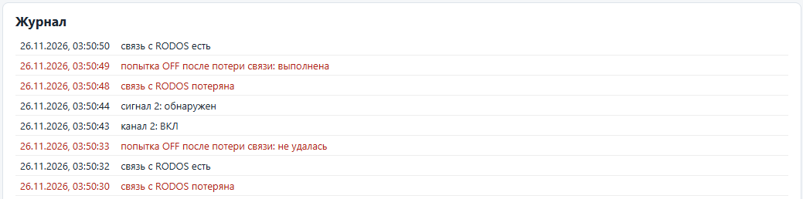
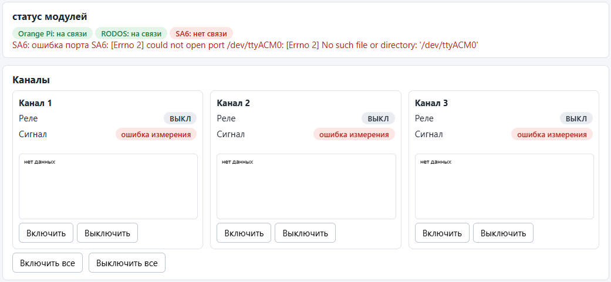

# Результаты проверки сценариев (раздел 11 ТЗ)
Интерфейс: `http://192.168.1.101:8000`.

| № | Сценарий | Как проверялось | Ожидаемый результат (ТЗ) | Результат |
|---|---|---|---|---|
| 1 | Запуск системы | `sudo systemctl restart rf-monitor`; открыть интерфейс; в журнале запись "при запуске отправлен OFF на каналы 1-3" | Веб-приложение доступно; реле 1–3 в OFF; автовключения нет | Пройден |
| 2 | Управление одним каналом | Кнопки "Включить"/"Выключить" поочерёдно на каналах 1, 2, 3; остальные каналы не меняются | Каждое реле независимо включает и выключает свой сигнал | Пройден |
| 3 | Одновременная работа | Кнопка "Включить все" | Три сигнала излучаются одновременно и обнаруживаются SA6 | Пройден |
| 4 | Первичная калибровка | Кнопка "Запустить калибровку" (скан 100–2000 МГц, 5 сканов, три канала включены) | Найдены три пика, пресет сохранён | Пройден |
| 5 | Мониторинг по пресету | После калибровки наблюдать карточки каналов | Измеряются узкие окна (±3 МГц) сохранённых частот; результат отдельно по каждому сигналу | Пройден |
| 6 | Частичная комбинация | Включить 1 канал, затем 2 канала, остальные выключить | Выключенные не отмечаются "обнаружен"; включённые обнаруживаются | Пройден |
| 7 | Потеря связи с RODOS / SA6 | Отключить сетевой кабель RODOS; отдельно — USB SA6 | Показана ошибка; реле "неизвестно" / "ошибка измерения", а не прежнее значение; интерфейс не зависает | Пройден |
| 8 | Перезапуск Orange Pi | `sudo reboot`; после загрузки открыть интерфейс | Пресет и журнал сохранены; реле в OFF; генератор не включился сам | Пройден |

## Подробности по сценариям

### 1. Запуск
- Сервис стартует автоматически (`systemctl enable`), интерфейс открывается.
- На каналы 1–3 отправляется OFF; если RODOS недоступен, отправка повторяется каждые 3 с, пока не пройдёт.

### 7. Потеря связи
- RODOS: бейдж "RODOS: нет связи", состояние реле "неизвестно / нет связи"; в журнале "связь с RODOS потеряна" и попытка OFF.
- SA6: бейдж "SA6: нет связи", статус сигналов "ошибка измерения"; мониторинг продолжает попытки и восстанавливается после подключения.

### 8. Перезапуск
- `preset.json` и `log.db` лежат в `/opt/rf-monitor/data` на накопителе и после перезагрузки на месте.
- Состояние реле после загрузки читается с RODOS заново, а не из `state.json`.

## Скриншоты

**Сценарий 2 — управление одним каналом.** Включён только канал 2, остальные выключены и "не обнаружены"; все модули на связи.

**Сценарий 3 — одновременная работа.** ЭВключить все": три реле ВКЛ, три сигнала обнаружены.

**Сценарий 4 — первичная калибровка.** Спектр 100–2000 МГц, найденные пики 423 / 433 / 443 МГц, сохранённый пресет (дата, параметры скана и окна).

**Сценарий 5 — мониторинг по пресету.** Узкие окна ±3 МГц вокруг сохранённых частот, результат отдельно по каждому каналу (см. также снимки сценария 6).

**Сценарий 6 — частичная комбинация.** Один канал включён: обнаружен только он.

Два канала включены: оба обнаружены, выключенный канал не обнаружен.

**Сценарий 7 — потеря связи с RODOS.** Состояние реле "неизвестно / нет связи", сообщение "RODOS недоступен". Сигнал по-прежнему показывается по измерениям SA6, а не по состоянию реле.

Журнал: потеря связи, попытка OFF (при недоступном RODOS — "не удалась", после возврата связи — "выполнена"), восстановление связи.

**Сценарий 7 — потеря связи с SA6.** Бейдж "SA6: нет связи", текст ошибки порта, статус сигналов "ошибка измерения", графики пустые.

